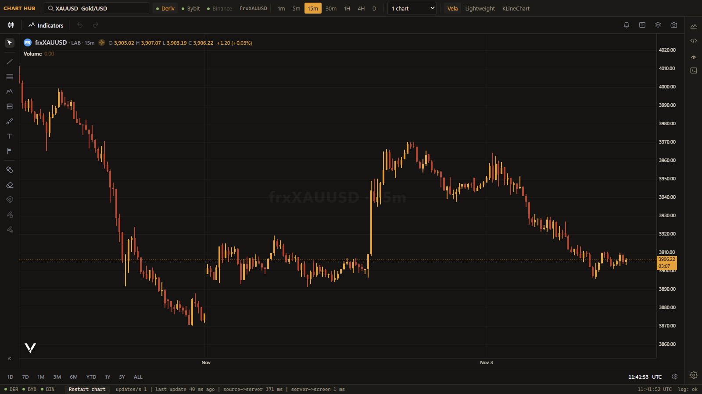
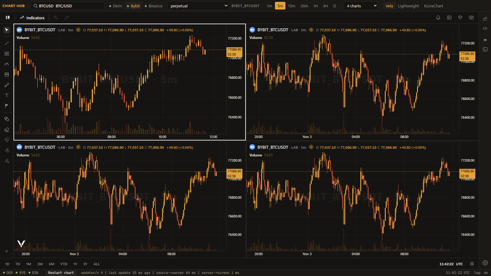
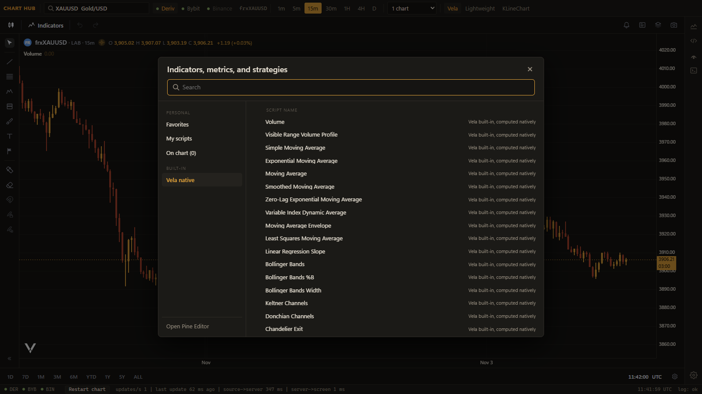
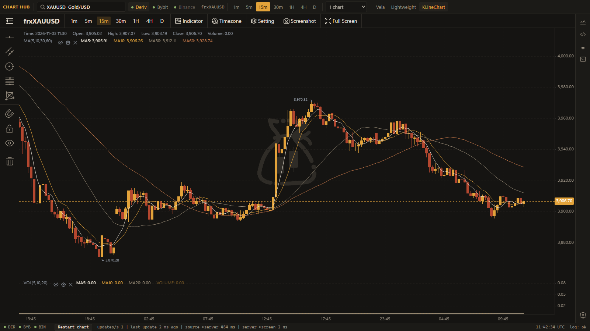
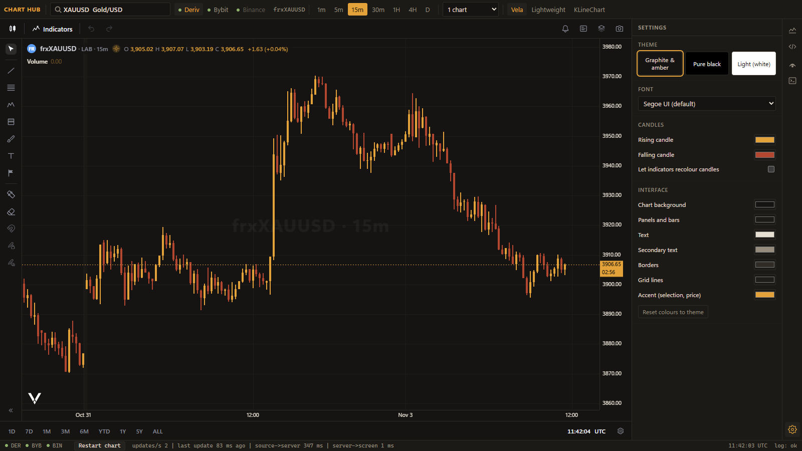

# Open Source TradingView

A free, self-hosted, TradingView-style charting app ("Chart Hub") that runs on your own computer.
It puts one interface over several free market-data feeds and three chart engines. It runs Pine Script
indicators and can also show candles from your own MetaTrader 5 terminal, on this PC or on a VPS.

> Not affiliated with, endorsed by, or connected to TradingView, Inc. "TradingView" is their trademark.
> This project is an independent open-source tool. It is not financial advice.



| Four synced charts (Bybit BTC) | Indicators dialog |
|---|---|
|  |  |
| **KLineChart engine** | **Themes, fonts and candle colours** |
|  |  |

## What it does

- **Free feeds, no account needed:** Deriv (forex, gold, indices, crypto), Bybit (about 3,300 crypto
  and metal markets) and Binance (crypto). They work out of the box.
- **Your own MetaTrader 5 (optional):**
  - **Local MT5:** a terminal on this Windows PC (any broker).
  - **Remote MT5:** a terminal on a VPS or cloud server, reached through an SSH tunnel and a small bridge
    (`bridge/mt5_bridge.py`). The bridge only reads candles. It never places orders.
- **The broker switch keeps the instrument.** Gold stays gold when you move from Deriv to Bybit to MT5.
  Only exact matches are joined, so gold tokens such as PAXG are kept separate from gold spot.
- **Three chart engines, one switch:** Vela (main engine, with Pine Script, 70+ native indicators, 75 drawing
  tools and layouts of up to 16 synced charts), Lightweight Charts with 86 drawing tools, and KLineChart Pro.
- **Pine Script:** write or import your own scripts in the Pine Editor. Scripts written for v1 to v4 are
  converted to v5 automatically and the original is kept. Converted values are not verified
  against any reference yet, so check them before you rely on them.
- **Backend log panel:** one live, redacted view of every feed: reconnects, lag, silent streams.
- **Safe by default:** binds to `127.0.0.1` only and serves only a whitelist of static files. With nothing
  configured, it never opens an SSH link.

## Quick start

Requirements: Python 3 (tested on 3.14). Node.js is not needed to run it; the built bundle is included.

```bash
git clone https://github.com/saifullahshafin/open-source-tradingview.git
cd open-source-tradingview
python -m venv .venv
# Windows: .venv\Scripts\activate      macOS/Linux: source .venv/bin/activate
pip install -r requirements.txt
cp .env.example .env        # optional: only needed for MT5
python hub/server.py
```

Then open <http://localhost:8770/hub.html>. On Windows you can double-click `start.bat` instead.

## Connect MetaTrader 5 (optional)

**MT5 on this Windows PC:** install MetaTrader 5, log in to your account, then run `pip install MetaTrader5`
and set `LOCAL_MT5=1` in `.env`. A "Local MT5" feed appears.

**MT5 on a VPS or server:** step-by-step instructions are in [AGENTS.md](AGENTS.md#remote-mt5-on-a-vps). In short:
1. On the server: run MT5, enable its MCP server (Tools > Options), then start
   `MT5_MCP_TOKEN=... python3 bridge/mt5_bridge.py`. It listens on `127.0.0.1:8797` only.
2. On your PC: add the server to `~/.ssh/config` (key login) and set `REMOTE_MT5_SSH_HOST=<alias>` in `.env`.
3. Restart the hub. It opens the SSH tunnel itself and reconnects if the link drops. A "Remote MT5" feed appears.

## Let your AI agent set it up

[AGENTS.md](AGENTS.md) is written for coding agents (Claude Code, Codex, Cursor and similar). It gives the exact
install, run and check steps for every setup (free feeds, local MT5, VPS MT5), the expected outputs, and the
security rules. Point your agent at it: *"Read AGENTS.md and set this up for me."*

## Project layout

```
hub/        the app: server.py (data + web server), hub.html (the shell), engine pages, Pine tools
bridge/     mt5_bridge.py: read-only candle bridge for a remote MT5 terminal
build/      source and build script for hub/vela.bundle.js and hub/vendor (npm)
docs/       screenshots
licenses/   third-party licence and notice files
```

## Roadmap

- Price and Pine alerts (built privately, not yet ported to run without a server)
- Accuracy tests: candles against the broker, Pine values against reference values
- Pine Script on the Lightweight and KLineChart engines
- Drawings that carry across engines

## Licence

**AGPL-3.0-only** (see [LICENSE](LICENSE)), because the bundled Pine Script engine
([PineTS](https://github.com/LuxAlgo/PineTS) and [Vela-pinets](https://github.com/LuxAlgo/Vela-pinets)) is AGPL-3.0. If you run a
modified version for other people over a network, you must offer them its source.
Third-party parts keep their own licences. See [THIRD_PARTY_NOTICES.md](THIRD_PARTY_NOTICES.md).
Market data belongs to its providers. Check each feed's terms before any public or commercial use.
